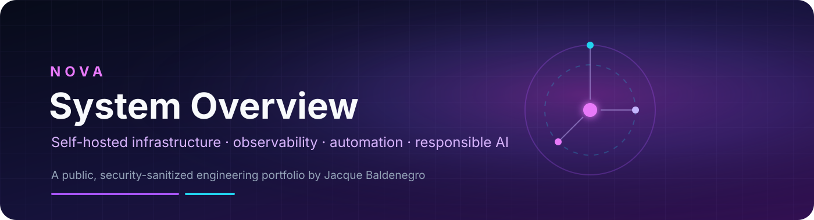

  

  <strong>Private by design. Observable by default. Honest about what is still being built.</strong>

Nova is a private, self-hosted personal operations platform that I design and operate across Windows, WSL2, and Docker. It brings infrastructure, monitoring, automation, documentation, recovery practices, and responsible AI experiments into one system I can understand, test, and improve.

This repository is a security-sanitized portfolio and case study. It explains the architecture and the work without publishing the private source repository, live configuration, credentials, addresses, hostnames, service data, or personal information.

  

## Project status

Latest evidence: **October 11, 2026 — full media automation live and Nova AI memory core operational**. Owner-driven October 10 transition: the gated owner-attended flow was superseded by the owner-approved automated pipeline, and the Nova AI core (memory pipeline, daily synthesis, deep memory layers) went live. The Gate remains stopped and latched as retained historical evidence; revival or retirement is an open owner decision.

The technical evidence column records what was verified. The final column explains the practical meaning without changing the status or its limitations.

| Area | Status | What the evidence supports | Plain-language summary |
|---|---|---|---|
| Docker and WSL2 foundation | **Working** | The reconciled recovery baseline covers 22 expected services; experimental services are tracked separately. | Nova's core services are running together on a stable local foundation. |
| Boot recovery | **Validated** | A Windows AtLogOn task launches a passive WSL2 verifier with bounded convergence. Repeated cold boots ended healthy with no unexpected container recreation. | After a restart, Nova waits for core services to come online and verifies that they returned safely. |
| Service access and navigation | **Working** | Homepage and Caddy passed direct and routed availability checks across the Windows/WSL boundary. | The main dashboard and service routes are reachable from the host environment. |
| Observability | **Working foundation** | Prometheus verified three authoritative host/exporter target classes. Grafana, Loki, Promtail, Node Exporter, and Uptime Kuma were running; dashboard, alert, and retention coverage still varies. | Nova can monitor the health of its main systems, though monitoring coverage is still growing. |
| Home automation | **Working** | Home Assistant was running. Internal entities, locations, and automations remain private. | Home-automation services are available, while private household details remain unpublished. |
| Media workflow | **Fully automated; live production** | October 10, 2026: the owner approved full automation and the entire chain ran unattended end-to-end — request interface → indexer search → movie/TV managers → VPN-bound download client → automatic import → media server. Six titles auto-imported in one day; deletion verified to remove files from disk; automatic re-acquisition verified. Seeding is preserved with ratio targets and no time cap. | Requests now resolve to completed media in the library without owner attendance. |
| Backup and recovery | **Partial** | Recovery artifacts, controlled repair procedures, and boot verification exist. Off-host coverage and isolated restore testing are not complete for every service. | Nova has documented recovery options, but not every service yet has complete off-site backup and restore proof. |
| Nova AI core | **Operational; verified live** | Owner declared October 11, 2026 that the personal assistant runs on a self-hosted agent runtime with a separately-billed open model. A daily loop collects deterministic facts at 07:00, an AI synthesis pass writes the morning brief + ranked attention queue at 07:15, and a Sunday weekly pass reviews the second brain. Five deep-memory layers run file-based and locally: an append-only event ledger (Chronicle), a fact-lifecycle store with supersede-never-delete (Codex), an entity index over the knowledge vault (Atlas), evidence-linked distilled patterns (Wisdom), and source-enforcement on every claim (Evidence). All verified with real runs; no external memory provider or cloud service is involved. | Nova has a working local memory system: it records what happened, keeps only verifiable current facts, and writes the owner a brief every morning. |
| Nova-native software | **Deployed** | The memory-layer tools (ledger, fact lifecycle, entity index, pattern distillation, synthesis merger) run as guard-enforced, stdlib-only Python in the Linux environment; the dashboard serves the daily brief to intelligence cards via the local reverse proxy. | Nova's own software is now running as live services, not prototypes. |
| Advanced AI operations | **Partial** | Persistent memory, daily/weekly consolidation, and evidence enforcement are live. Autonomous actions, external retrieval providers, and multi-step tool orchestration remain roadmap work. | Nova remembers and reports; it does not yet act on systems without the owner. |

## Recent engineering milestones

### October 2026: full media automation (owner-approved)

After the owner-driven Level 1 acceptance below, the owner chose full automation. The request interface, indexer search, movie/TV managers, VPN-bound download client, automatic import, and media server now run end-to-end without attendance. Verified: six titles auto-imported October 10; deletion from the media server removes files from disk; automatic re-acquisition works after deletion. Seeding is preserved (ratio target, no time cap) so the shared-indexer economy is respected. The Gate is stopped and latched as retained evidence — revival or retirement is an open owner decision.

### October 2026: Nova AI core and deep memory

The owner declared the personal assistant to be the self-hosted agent (chief of staff + memory core). The live system: deterministic facts pass (07:00 daily) → AI synthesis writes the morning brief and ranked attention queue (07:15) → served to dashboard intelligence cards; Sunday weekly review. Five file-based deep-memory layers, all guard-enforced and locally stored: Chronicle (append-only event ledger), Codex (fact lifecycle: current/uncertain/superseded/expired, supersede-never-delete), Atlas (entity index over the knowledge vault), Wisdom (evidence-linked patterns, advisory only), Evidence (every claim must carry a source; unsourced items refused at merge).

Read [Building a Fail-Closed Media Acquisition Pipeline](docs/case-study-download-security-gate.md).

## Why I built Nova

I wanted a place where I could learn the full lifecycle of technical operations instead of studying each tool in isolation. Nova gives me a real environment in which to discover requirements, connect systems, troubleshoot failures, protect state, document decisions, and improve the experience of operating the whole platform.

The project is also a practical response to common operational problems:

- Service sprawl without a clear source of truth
- Configuration drift between intended and live state
- Limited visibility into health, metrics, and logs
- Recovery knowledge that exists only in one person's memory
- Asynchronous startup behavior hidden by fixed delays
- Automation ideas that need explicit safety and approval boundaries
- AI concepts that are easy to describe but much harder to validate responsibly

## Verified capabilities and dated foundation

- Docker-based self-hosted environment under Linux and WSL2
- Private host-level networking through Tailscale
- Homepage navigation and Caddy reverse-proxy services
- Prometheus metrics with three verified authoritative target classes
- Grafana visualization, Loki logs, Promtail collection, Node Exporter, and Uptime Kuma
- Production-validated, fail-closed post-logon convergence verification
- Home Assistant for home-automation experimentation
- Jellyfin-centered services with live owner-driven Level 1 acquisition, Gate validation, explicit release, import and cleanup verified
- Vaultwarden for private credential management
- Open WebUI as an AI experimentation interface
- Git-based source control for engineering material
- Documented backup, recovery, troubleshooting, and verification procedures

## Architecture

  

The diagram shows trust boundaries and service groups rather than live network details. [View the readable architecture diagrams](docs/architecture.md#diagrams) or [inspect the Mermaid source](diagrams/nova-public-architecture.mmd).

Nova's boot path is documented separately because startup convergence is easier to understand as a sequence. [View the readable Boot Recovery sequence](docs/case-study-boot-recovery.md#2-architecture) or [inspect its Mermaid source](diagrams/nova-boot-recovery.mmd).

## About the Builder

**Designed, built, operated, tested, and documented by Jacque.**

Nova is my personal systems engineering project focused on reliability, security boundaries, observability and recoverable infrastructure. It demonstrates hands-on learning and evidence-led implementation, rather than a claim of professional security credentials.

## Technology stack

| Layer | Technologies |
|---|---|
| Host and runtime | Windows 11, WSL2, Ubuntu, systemd, Docker, Git |
| Private access | Tailscale, Caddy |
| Boot verification | Windows Task Scheduler, PowerShell, Bash, bounded health and dependency gates |
| Observability | Prometheus, Grafana, Loki, Promtail, Node Exporter, Uptime Kuma |
| Interfaces | Homepage, Portainer, Open WebUI |
| Home automation | Home Assistant |
| Media operations | Jellyfin, Jellyseerr, Sonarr, Radarr, Prowlarr, Bazarr, qBittorrent, Gluetun, Recyclarr, FlareSolverr |
| Download validation | Python, SQLite, Bubblewrap, libmagic, FFprobe, ClamAV, Microsoft Defender |
| Documentation | Markdown, Mermaid, Obsidian, operational runbooks |
| AI roadmap | Retrieval evaluation, human review, model routing concepts, MCP concepts |

## Selected engineering work

- Built and qualified a durable validation/release boundary across Windows, WSL2 and Linux, including actual asynchronous moves and restart behavior

- Diagnosed runtime/source drift and rebuilt an evidence-backed operating baseline
- Recovered stateful services from stale cross-distro bind mounts without resetting application state
- Diagnosed a qBittorrent restart loop, preserved state, applied a minimal repair, and verified recovery with acceptance checks
- Reconciled reverse-proxy and media storage paths after routing and mount failures
- Built authoritative Windows, WSL2, and container telemetry
- Designed a passive boot verifier with fail-closed VPN checks and bounded convergence
- Used repeated real cold boots to isolate Docker, VPN, proxy, and telemetry timing races
- Built operational trackers, verification queues, recovery records, and public-safe architecture maps
- Separated observed evidence from assumptions, prototypes, and roadmap ideas

## Current limitations

- Full media automation is live, but automation quality controls are still maturing: no formal regression suite runs on the automated path (the 614-test Gate suite belongs to the retired attended flow), and config-drift checks are periodic rather than continuous.
- The private environment still has configuration and documentation drift to resolve.
- Some services lack application-level health checks.
- Observability targets are verified, but dashboard, alert, notification, and retention coverage is not uniform.
- Backup coverage is uneven, and not every critical service has an off-host copy and isolated restore test.
- The boot verifier observes and classifies convergence; it is not a general-purpose remediation engine.
- Security hardening is ongoing. Privileged integrations and service exposure require continued review.
- Nova AI operates read-mostly: it writes only its own guarded data files and a morning brief. It does not perform autonomous system actions; autonomous action and multi-step orchestration remain unbuilt.
- No production RAG, external retrieval provider, MCP, or autonomous-action capability is claimed.

## Responsible AI and human control

Current development uses owner-scoped, AI-assisted campaigns with acceptance evidence and explicit stop conditions. [Human-governed AI engineering](docs/operations-and-recovery.md#human-governed-ai-engineering) describes the method.

Nova's AI roadmap starts with an operational rule: the model is not the source of truth. Evidence, source provenance, approval boundaries, and recoverability matter more than an impressive demo.

Planned AI workflows will be evaluated for answer quality, failure behavior, permissions, logging, and human handoff before any action capability is considered. Actions that affect systems or data should remain explicit, reviewable, and reversible.

## Roadmap

- **Completed:** Gate architecture/deployment/admission, release/moving safety, tested recovery, Internet acquisition, Sonarr/Jellyfin delivery, Level 1 policy/enablement, emergency rollback/re-entry, installed owner interface, first live owner transaction, **owner-approved full media automation (October 2026)**, **Nova AI core with five-layer deep memory (October 2026)**.
- **Current:** **full automation in operation** + **Nova AI daily memory loop** (facts → synthesis → dashboard, Sunday weekly review). Observing both; the Gate revival-or-retirement decision is the owner's.
- **Next:** job-search tooling (owner's priority), Gate decision, Nova AI polish (wisdom refinement, voice tuning).
- **Later:** broader recovery and observability coverage, evaluated retrieval providers and MCP, autonomous-action capability only after explicit permission design.

Read the complete [Roadmap](docs/roadmap.md).

## Documentation

For a concise interview walkthrough: [Gate case study](docs/case-study-download-security-gate.md) -> [Architecture](docs/architecture.md) -> [Boot Recovery V1 case study](docs/case-study-boot-recovery.md) -> [Current state](docs/current-state.md) -> [Roadmap](docs/roadmap.md).

| Document | Purpose |
|---|---|
| [Architecture](docs/architecture.md) | Sanitized structure, trust boundaries, and data flows |
| [Current state](docs/current-state.md) | Component-by-component evidence and limitations |
| [Build history](docs/build-history.md) | Selected milestones and what changed |
| [Observability](docs/observability.md) | Metrics, logs, availability, and verification boundaries |
| [Operations and recovery](docs/operations-and-recovery.md) | Change safety, backups, boot verification, and recovery method |
| [Security and privacy](docs/security-and-privacy.md) | Publication boundaries and security posture |
| [Lessons learned](docs/lessons-learned.md) | Practical technical and operational takeaways |
| [Download Security Gate case study](docs/case-study-download-security-gate.md) | Isolation, state machines, real validation, asynchronous release and bounded recovery |
| [Boot Recovery V1 case study](docs/case-study-boot-recovery.md) | Bounded post-logon convergence across Windows, WSL2, Docker, VPN, proxy, and telemetry |
| [qBittorrent recovery case study](docs/case-study-qbittorrent-recovery.md) | Evidence-led diagnosis and minimal repair |

## Privacy and security

The private Nova repository and its Git history have not been published or copied here. This repository contains newly written documentation, synthetic examples, and sanitized diagrams only. Screenshots were intentionally omitted because a useful screenshot could also disclose operational details.

For more information, read [Security and privacy](docs/security-and-privacy.md) and [SECURITY.md](SECURITY.md).
